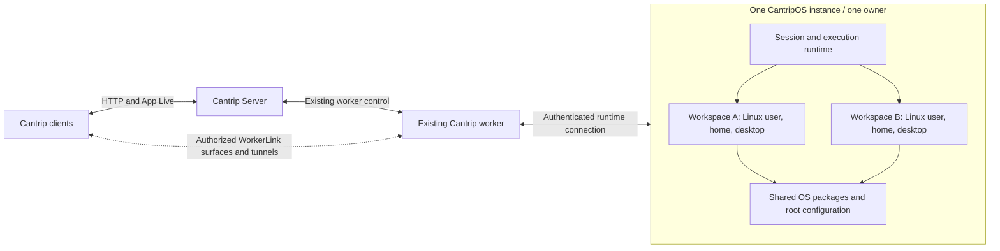

# CantripOS

- Status: Phase 3 execution and source ownership implemented and exercised in Docker
  and an installed VM. Phase 4 Linux computer use, integrated human control and
  managed SSH/SFTP/VNC/TCP are implemented; final Phase 4 acceptance is in progress.
- Updated: 2026-11-05.
- Scope: a customized, bootable Linux distribution for one Cantrip owner's
  agents, also distributed as a directly runnable Docker image.

## Foundation checkpoint

The first personal-testing foundation is implemented under
[`cantrip_os/`](../cantrip_os/README.md), using Debian 13 and IceWM. Docker has
automatic desktop entry, a localhost browser viewer, persistent home data, and
a watched rebuild/reconnect loop. The shared configuration also builds a
live/install AMD64 ISO, tested through installation and BIOS/UEFI disk boot.
See [the acceptance record](../cantrip_os/ACCEPTANCE.md) for exact evidence and
unverified targets.

Multiple workspace sessions ship as the optional `cantrip-os-workspaces` Debian
package. Version 0.3.0 supplies persistent Linux accounts, lazy IceWM desktops,
CLI lifecycle commands, a local workspace selector, and direct browser desktop
links. The ordinary personal desktop remains usable without that package.
The separate executor package now connects these workspaces to the owning worker.
The native Linux capture/input backend and optional
[`cantrip-os-remote`](../cantrip_os/packages/remote/README.md) carrier are Phase 4
checkpoints. Normal agent/preview routing selects the captured Linux display,
including clipboard and resizing. An integrated source-bound desktop view now
shares that helper over WorkerLink, including exclusive human takeover. Remote
0.7.0 supplies protected guest SSH/SFTP/VNC/TCP carriers and managed product
routes, including explicit Guest-to-Host forwarding. Final distribution/stream
acceptance remain in progress.

## Optional package architecture

The OS foundation owns Debian, IceWM, theme defaults, applications, automatic
personal login, and the personal desktop's Docker viewer. Workspace management
is an additive `.deb` built from `cantrip_os/packages/workspaces/`, with its own
CLI, service, configuration, versioned state, and workspace viewer.
Both Docker and ISO builds can include or omit it with
`CANTRIP_OS_WORKSPACES=1` or `0`. The worker remains the orchestrator.

The package uses a systemd unit on installed systems and the same foreground
daemon with package-owned lifecycle commands in Docker. The container's small
startup hook starts/stops the optional service independently of its personal
desktop. Package failure or removal must not stop that desktop.

Configuration is a Debian conffile at `/etc/cantrip-os/workspaces.json`.
Persistent state and workspace homes live beneath
`/var/lib/cantrip-os-workspaces`, mounted as a separate named Docker volume.
Runtime sockets and locks live under `/run/cantrip-os-workspaces`. Administrative
control uses a root-only Unix socket. A package-owned noVNC/websockify gateway
provides the local single-owner browser UI on port 6081; installed systems bind
loopback, and Docker publishes it only on host loopback. Each viewer explicitly
selects a workspace and current session generation. No worker enrollment or public
remote endpoint is added by installing this package.

Disable and removal retain state, homes, browser profiles, and the saved
enable/disable preference. Data deletion requires a separate explicit action;
package purge does not imply workspace data deletion. Unknown state versions
must fail visibly without overwriting the data.

Phase 2 ships in sequential PR/worktree/auto-merge cycles: package and service
lifecycle first; persistent accounts and independent desktop sessions second;
workspace viewing, Docker/installed-VM acceptance, current ISO, and 4 GiB resource
measurements third. Each dependent cycle begins only after the previous merge.

The phase-2 acceptance record covers Docker and installed-VM lifecycle, browser
input/clipboard separation, retained profiles, shared sudo/package installation,
and measured 4 GiB resource use. Execution and source ownership are supplied by
the separate executor package. The workspace package itself does not provide
agent orchestration or Linux computer use.

Phase 3 was delivered through sequential PR/worktree/auto-merge cycles. The
optional `cantrip-os-executor` 0.9.0 package runs the pinned native executor as
selected workspace accounts, with unrestricted sudo. The existing worker keeps
orchestration, the app-server, model-provider credentials and authenticated MCP;
Cantrip Server retains placement, leases and conversation authority.

[Source provisioning](../cantrip_os/SOURCES.md) supports an exact linked Docker
worktree, explicit Linux dependency overlays, and independent Linux-owned
checkouts/worktrees. [Native execution](../cantrip_os/NATIVE_RUNTIME.md) routes
shell/PTY, reads/search, patches/writes and relevant native file watching into the
captured source. [Product workflows](../cantrip_os/PRODUCT_WORKFLOW.md) connect
attachment/selection, terminals, editor/Explorer, setup/Run, uploaded files and
returned artifact links. Run configurations are combined in one list with
per-configuration destinations. `cantrip-desktop` explicitly uses the assigned
workspace display while ordinary shells remain independent of desktop lifetime.

The [acceptance record](../cantrip_os/ACCEPTANCE.md#phase-3-acceptance-and-distribution-2026-11-04)
distinguishes real-model product evidence from deterministic native fixtures.
Actual tests cover both source modes, selected UID/cwd/bytes, returned artifacts,
root process-tree cancellation, uncertain transport outcomes, retained identities
and data, stale-handle rejection, package disable/remove/reinstall, a fresh Docker
image and live ISO installation followed by disk boot without the ISO.

Public Docker/ISO scripts include the optional executor by default.
`CANTRIP_OS_EXECUTOR=0` omits it; `CANTRIP_OS_WORKSPACES=0` defaults to omitting both
integration packages. An explicit executor selection wins. The ordinary Debian/
IceWM desktop remains usable without either package. Host-only MCP Run/worktree/
task-creation adapters are unavailable in Linux sessions; use the source-aware
product workflows. Phase 4 adds Linux computer use and integrated viewing. Human
control is implemented; general SSH/SFTP/TCP services, cloud provisioning, mirroring and backups remain
in progress or later phases. The tested matrix and provider/platform limitations
are recorded rather than implied to work on untested hardware.

The canonical model keeps `project_sources.absolute_path` worker-local. A shared
source identity preserves worktree IDs and leases, while Linux-owned source
details use `guest_path` in separate rows. Linked bindings retain the original
source/worktree and capture its exact worker path; they do not create replicas
or fake workers. Bindings capture an OS workspace and immutable configuration
generation. A successful provisioning receipt records the attachment and runtime
generations that verified the files. A restart, path change, reattachment, retired
binding, or unavailable worker invalidates execution until the intended placement
is verified again. Guest unavailability never authorizes host execution.

## Product intent

CantripOS gives agents a Linux computer they can freely use without moving the
human's host pointer, stealing host application focus, or installing software
onto the human's host operating system. It includes a lightweight graphical
environment, Chromium, terminals, development tools, and Cantrip integration.
The owner must also be able to boot an ISO, log into a real desktop, and tinker
with the installed OS directly.

The existing Cantrip worker remains the primary orchestrator. CantripOS is an
execution and computer-use tool attached to that worker. It does not replace
Cantrip Server, own the agent conversation, schedule autonomous work, or require
a full Cantrip worker in every desktop session.

This plan supersedes earlier suggestions to require a full worker inside each
desktop or to isolate every agent in its own container. The selected design is
one owner per CantripOS instance, with multiple workspace accounts and desktops
inside that instance and unrestricted root access available to its agents.

## Fixed decisions

1. A CantripOS instance belongs to exactly one Cantrip owner/account. Different
   customers never share an instance. Several agents and projects belonging to
   that owner may use it concurrently.
2. Agents may obtain unrestricted root within the entire CantripOS instance.
   Workspace accounts and desktops provide organization and independent focus,
   not a security boundary against other agents with root.
3. A real bootable OS is a required deliverable, including a live/install ISO,
   a usable local desktop, and VM/cloud disk images. Docker is also a required
   deployment, not a substitute for the bootable edition.
4. Several workspace desktops share the instance's operating system, services,
   installed packages, and resources. No per-agent VM or nested container is
   required in the default design.
5. The worker owns orchestration and delegates execution, filesystem access,
   desktop operations, and service access to small CantripOS runtime components.
6. An environment-bound agent uses the Linux shell and Linux filesystem view by
   default. Host execution remains explicitly selectable; failures never cause
   silent fallback to host execution or the host desktop.
7. Local Docker supports linking existing worktrees through writable bind
   mounts. Remote machines default to Linux-owned checkouts. Universal live
   mirroring is not required.
8. Persistent home directories, browser state, source files, and installed
   software have explicit lifecycles. Stopping is different from resetting or
   replacing an instance.
9. Cantrip owns the desktop integration and protocol routing. Webtop, VNC, RDP,
   and streaming implementations are implementation options, not product
   identity or orchestration requirements.
10. Performance is measured rather than used to remove required deployment
    options. A slower Docker edition remains useful and supported within its
    documented platform capabilities.

## Linux distribution and deployment model

Build a Debian-based distribution remix using a pinned Debian release, shared
package manifests, configuration overlays, and versioned Cantrip packages.
Maintain a conventional Linux installation with a package manager and normal
administration tools. Do not build a new kernel or package ecosystem.

The initial desktop choice is IceWM with Chromium, a terminal, a file manager,
common fonts, clipboard support, and accessibility infrastructure. Ship basic
Git, SSH, shell, and development utilities. Additional language toolchains are
installable profiles rather than a requirement to put every SDK in the base
image. Use software rendering as a supported baseline; GPU acceleration is
optional and must not be necessary to boot or perform ordinary computer use.

| Edition          | Execution model                                                            | Required behavior                                                                                     |
| ---------------- | -------------------------------------------------------------------------- | ----------------------------------------------------------------------------------------------------- |
| Docker/OCI       | One container runs one CantripOS userspace with several workspace sessions | Starts directly under Docker on a worker machine; private virtual displays; no nested Docker required |
| VM/cloud         | A bootable disk image runs the CantripOS kernel and userspace              | Normal Linux boot, persistent disk, SSH, remote desktops, and provisioning hooks                      |
| Live/install ISO | Bootable media runs a live system and can install CantripOS                | Owner can boot in a VM or on supported physical hardware and customize the desktop/OS                 |

These artifacts share packages and defaults, not an identical boot sequence.
The VM and installed editions use the normal Linux boot/init stack. The Docker
edition starts the necessary services through a container-appropriate init and
supervisor, including session D-Bus and virtual displays. It does not need to
emulate boot firmware or run a VM inside Docker.

Docker runs the distribution's userspace against the Docker host's Linux
kernel; Docker Desktop supplies that kernel through its Linux VM. Therefore
root in the Docker edition controls its whole CantripOS userspace but does not
automatically control the outer host kernel, devices, or Docker daemon. This
is an inherent deployment difference, not a restriction between agent
workspaces. VM/hardware installs provide the normal machine-level root and
kernel administration behavior. Kernel changes and physical device operations
must report their actual platform result rather than being advertised as
identical across editions.

Do not mount the outer Docker socket, human home directory, or human display
sockets as part of the default setup. Sharing a selected project directory is
intentional. Enabling a special device or host integration is an explicit
instance configuration, not an automatic escalation after an operation fails.

## Ownership and architecture

An **OS instance** is one Docker container, VM, or physical CantripOS machine.
An **OS workspace** is a persistent execution context with a home directory,
source bindings, and an optional desktop. This term does not redefine the
existing server-owned Cantrip workspace/sidebar grouping.
A **desktop session** is a graphical login/display inside an OS workspace.



Cantrip Server continues owning canonical product state, authorization,
placement, durable jobs, and conversation history. The worker remains the
registered execution owner and routes operations to its attached OS runtime.
Physical paths, processes, and bytes may reside in CantripOS; the worker's
existing local-filesystem assumptions must be extended explicitly rather than
pretending those paths exist on the worker machine.

CantripOS needs these narrowly scoped components:

- A session manager for workspace accounts, display/session startup, process
  ownership, lifecycle observation, and connection recovery.
- A process/filesystem executor for shell jobs, PTYs, reads, writes, searches,
  and cancellation.
- A Linux computer-use backend for capture, input, target discovery, clipboard,
  and later accessibility operations.
- Service endpoints for authorized desktop viewing, SSH/SFTP, and forwarding.

The pinned Codex tree already contains and packages `codex-exec-server`, a
standalone process/filesystem server. Evaluate reuse of that executor before
implementing an equivalent protocol. Its existence is not evidence that
Cantrip's native file tools, Run environments, or all Codex tools already use
remote execution. Prove that integration against the actual pinned runtime.

Do not copy provider accounts, agent schedulers, conversation databases, or
full worker enrollment into each workspace. Runtime credentials authorize
this owner's instance connection and are distinct from model-provider keys.

The worker must remain available for continued agent orchestration. A shell
process may survive a transport interruption under its recorded lifecycle,
but CantripOS does not begin scheduling model turns on its own. A worker on an
always-on machine can manage cloud CantripOS without changing this ownership.

## Multiple accounts and desktops in one OS

Create a Linux account and persistent home for each OS workspace. Normal GUI
applications run as that user; passwordless sudo provides unrestricted root.
Use a separate display, session bus, runtime directory, browser profile, and
session process group for each workspace. Start the graphical session only
when requested; command execution alone does not require a running desktop.

Each desktop has independent pointer, keyboard focus, windows, and clipboard.
Agents in different desktops should not accidentally send input to each other.
Agents intentionally sharing one desktop also share its application focus;
provide an explicit controller lease and human takeover for that session.
Separate logical cursors alone do not create independent application focus.

The account separation is organizational. Root may inspect another workspace,
change its files, stop its processes, or alter shared services. This is accepted
because all agents belong to the same owner. Do not describe CantripOS as
multi-tenant isolation or require per-agent containers to solve this accepted
tradeoff. Different Cantrip customers need different OS instances; stronger
machine isolation, if needed for hosting, is outside this single-owner design.

Root package installation changes the OS for every workspace. Default package
operations should use the distribution's native transaction/locking behavior;
Cantrip setup jobs can serialize their own shared-system changes. Root users
can bypass those conventions. Report actual conflicts and affected sessions,
and never claim that workspace reset rolls back global package modifications.

The owner may log into the physical or VM console while agents use virtual
desktops. Agent desktop selection must not select the local human console by
default. A human can deliberately view or take over an agent desktop.

## Execution placement

Persist explicit bindings among owner, worker, OS instance, OS workspace,
project/source/worktree, and runtime generation. A target name or IP address is
not sufficient authority. Extend existing execution-target and source schemas
before enabling these placements; do not overload worker-local path fields
with remote paths or create a fake full worker for each desktop.

For an OS-bound chat, the following must agree on the selected Linux view:

- Native agent shell/PTY execution, working directory, and environment.
- File reads, writes, patch application, search, and file watching.
- Cantrip terminal tabs, Run actions, setup commands, and supervised services.
- Editor/Explorer operations and attachment or artifact materialization.
- Browser launches, desktop capture/input, and service destinations.

Changing only a shell command to `ssh ...` while leaving patch or read tools on
the host is not sufficient. Prefer the native executor/environment interfaces
and introduce adapters only where Cantrip still assumes local processes.
Host execution requires an explicit target and visible path mapping. It is
useful for linked worktrees, but is not the default for an OS-bound chat.

Runtime reconnection must distinguish observation from mutation. Reattach to
known process/session identities when supported; do not replay commands,
clicks, package installs, or file writes after uncertain delivery. Stop must
cancel the relevant process tree or input lifetime and release held controls.
An OS restart creates a new generation and invalidates old desktop handles.

Keep existing chat permission profiles and worktree leases authoritative for
operations routed through Cantrip. Root access inside the OS is an OS
capability; it does not change Cantrip account ownership or silently authorize
an unrelated project. These routing rules are not claimed to confine a root
agent already executing inside the single-owner OS.

## Source files, checkouts, and mounts

Support explicit source modes rather than claiming that a synchronized copy is
the same set of files.

| Mode                    | Default placement              | Source authority and behavior                                                                    |
| ----------------------- | ------------------------------ | ------------------------------------------------------------------------------------------------ |
| Linked worktree         | Docker on the worker's machine | Writable bind mount of the current worktree; host and Linux access the same files                |
| Linux-owned checkout    | Cloud VM or physical CantripOS | Checkout and worktrees reside beside Linux execution; worker delegates file/Git operations there |
| Remote filesystem mount | Optional later capability      | Source remains on another machine; network filesystem latency and disconnect semantics apply     |

A workspace binds its selected worktree at a stable path such as
`/workspaces/<workspace-id>/src`. Additional project, worktree, or data mounts
are explicit entries with their own source identity and access mode. Do not
mount all of an owner's projects automatically. One instance can host many
workspace accounts and their distinct bindings.

For local Docker, bind-mount the actual selected worktree. Changes made by the
agent on the host and by programs in Linux are real edits to the same files.
Root can also damage or delete the mounted files; desktop separation does not
make the shared worktree disposable. Preserve source ownership and avoid
recursive startup `chown` operations on user checkouts. Test UID/GID mappings,
symlinks, case behavior, executable bits, and file notifications on the actual
host platforms.

A bind mount belongs to the Docker daemon's machine. A cloud Docker daemon
cannot directly mount a laptop path. Remote instances therefore provision a
Linux-owned repository at a selected revision, then create/manage worktrees
there. Cantrip's editor and agent access that authoritative checkout through
the runtime. Non-Git folder projects can use explicit import/export without
pretending that they have repository/worktree semantics.

If a user also wants a local copy, use explicit Git synchronization or a
recorded transfer operation with dirty-file handling. Automatic bidirectional
mirroring is deferred. A future remote mount must document disconnection,
locking, caching, and execution behavior; current Finder/Explorer WebDAV shares
are not evidence of a suitable low-latency build filesystem.

### Git ownership

For a linked host worktree, keep Git mutation ownership with the original
worker initially. Linked worktree `.git` files can reference metadata outside
the mounted directory. Do not rewrite the host `.git` file or expose every
other checkout simply to make guest Git commands work. Clearly report this
limitation and offer worker-routed Git operations. Guest-native Git support
requires an explicit metadata-mount design and conflict/lease verification.

For Linux-owned repositories, Git and worktree operations execute in Linux via
the worker's delegated runtime. Extend source identity and leases to include
the OS binding; a second remote checkout is not the same source just because
its branch name matches. Preserve Cantrip's distinction among GitHub-managed
projects, attached local Git, and non-Git folders.

### Dependencies and ignored files

Bind mounts do not apply `.gitignore` filters. Ignored files may be required
inputs, secrets, datasets, or generated assets; `.gitignore` is not a transfer
or access policy.

For linked worktrees, support explicit Linux-specific directory volumes, such
as `node_modules`, `.venv`, or a toolchain's build/cache directory. They overlay
the corresponding paths only in the guest view. Document that these specific
paths are no longer the same files as on the host. Choose overlays from project
configuration rather than silently hiding every ignored directory.

Linux-owned checkouts keep their dependencies locally. Future transfers may
use Git ignore rules as suggestions, with an explicit manifest for tracked,
untracked, ignored, and secret inputs. Do not omit a tracked file merely because
an ignore rule also matches it. Provision secrets separately when practical.

## Desktop control, viewing, and networking

Implement a first-party Linux backend behind Cantrip's computer-use contract.
The initial virtual-session target is X11/Xvfb with XTEST-style input and
capture of the selected display. The bootable edition supplies a normal local
desktop in addition to virtual agent displays. Wayland and hardware acceleration
can be added without changing instance/workspace identity.

Input may move the real pointer and change global focus within the selected
virtual desktop. This is different from the macOS background-window backend:
there is no human host desktop in that virtual session to preserve. Never
silently substitute another display when the selected target disappears.
Coordinate scaling, clipboard, keyboard layouts, cancellation, and browser
interaction require actual Linux acceptance, not only fake-backend tests.

Use Cantrip's native Remote Desktop interface and authorized WorkerLink path
as the primary integrated viewing experience. Reuse existing capture/input
ownership where possible. Evaluate Selkies/Webtop streaming components and VNC
as implementation candidates; choose the initial stream adapter with measured
latency, CPU, memory, reconnect, and clipboard results. The current CUA capture
path does not establish hardware-video performance or a native Linux backend.

Provide SSH/SFTP and a VNC compatibility endpoint. RDP is optional. These are
access methods into the same workspace, not separate orchestration systems.
VLC was clarified as a reference to remote desktop access, not a requirement
for a particular media player or video format.

Extend the existing tunnel framework with explicit OS-instance/workspace
destinations for SSH, VNC, HTTP/HTTPS, development servers, and arbitrary
selected TCP services. Native clients can consume local forwarded ports;
browser/mobile clients need integrated viewers rather than promises of local
socket listeners. UDP, multicast/discovery, and protocols with negotiated
secondary connections require separate adapters; TCP support is not universal
protocol support.

The worker-to-OS connection is a new authenticated runtime boundary. For local
Docker, evaluate a framed non-TTY `docker exec -i` transport. For reachable
VMs/hardware, start with SSH host verification and authenticated channels.
Process lifetime and output retention cannot rely only on the transport's
client process remaining alive. Outbound-only enrollment and relay support are
a later transport milestone; current WorkerLink does not already provide
worker-to-worker or arbitrary runtime rendezvous.

Resolve service addresses from the environment where the service actually
runs. A host server and guest Chromium do not share `localhost`. Use explicit
forwarding for host services needed by linked workspaces; OS-bound development
servers and Chromium naturally share the Linux environment.

## Persistent state and customization

Maintain separate records for instance identity, workspace identity, desktop
sessions, and source bindings. Persist homes, documents, browser profiles,
workspace configuration, and Linux-owned repositories on durable storage.
Scope browser profiles to workspaces; do not run multiple browser processes
against one writable profile directory.

Reopening a workspace reuses its state. Restoring it elsewhere is an explicit
operation that closes applications or otherwise captures a consistent state.
Browser databases and OS keyrings are not automatically portable; retain
re-authentication as a possible outcome. Workspace templates may seed settings
and selected files, but must not silently copy another active session's keys
or cookies.

Credentials belong to the single owner's trust domain. Root can inspect them;
there is no promise of secrecy between root agents. Enrollment identities and
SSH host keys are generated per instance. Do not bake account credentials into
public images or duplicate live machine identities when cloning templates.

| Operation              | Meaning                                                                                                    |
| ---------------------- | ---------------------------------------------------------------------------------------------------------- |
| Close viewer           | Detach observation/control without deleting the desktop or workspace                                       |
| Stop desktop           | End that graphical session; preserve home/source state and identify affected processes                     |
| Stop instance          | Stop the OS/container; retain its disk or writable layer and persistent storage                            |
| Start instance         | Restart the retained instance and restore configured services; establish fresh runtime generations         |
| Reset workspace        | Explicitly recreate that account's selected state; does not undo shared OS package/configuration changes   |
| Reset/rebuild instance | Replace shared system state; explicitly select which homes/data survive and which source bindings reattach |
| Upgrade                | Apply a versioned update with recorded treatment of user/agent system customization                        |
| Save template          | Produce reusable configuration/image content with deliberate credential exclusion                          |
| Private backup/restore | Preserve consistent instance/workspace state, including separately protected sensitive data                |

For Docker, stop/start of the same container retains its writable layer.
Removing/recreating it loses system changes in that layer even if home volumes
survive. Do not silently recreate customized instances during image updates.
Provide explicit preservation/export or a documented reset path. VM/hardware
installs retain system state on disk. A live ISO session is disposable unless
persistence is configured or the OS is installed; the installer must make that
distinction visible.

Agents can modify or break the CantripOS helper itself. Root access allows
that. Keep lifecycle observation and recovery entrypoints in the owning worker
and retain SSH/console or Docker-management recovery where available. Report
the actual failure; do not claim that an internal service is immune to root.

## Build project and release artifacts

Create a dedicated `cantrip_os/` subproject in this repository when implementation
starts. This document does not create or switch to another repository.

```text
cantrip_os/
  packages/          Cantrip runtime and session-manager packages
  manifests/         Pinned Debian release and shared package profiles
  overlays/          Desktop, login, service, and provisioning defaults
  images/oci/        Multi-session CantripOS container recipe
  images/vm/         Bootable VM/cloud disk image recipes
  images/iso/        Live and installer build configuration
  scripts/           Build, inspect, run, export, and release entrypoints
  tests/             Boot, runtime, desktop, persistence, and protocol fixtures
```

Use Debian live-build for the live/install ISO and an appropriate Debian disk
image pipeline for VM/cloud outputs. Share manifests and packages across
artifacts, while keeping bootloader, kernel, firmware, cloud-init, and Docker
startup configuration in edition-specific recipes. Include a usable console
login/setup flow and ordinary package-management customization in the ISO.

Produce OCI images for AMD64 and ARM64. Start bootable-media acceptance on
AMD64 UEFI VMs and explicitly selected physical hardware; add ARM64 bootable
images through a separate verified target matrix. An ARM64 Docker image is
not evidence of a bootable ISO on Apple Silicon or arbitrary ARM hardware.
Use Linux builders or Linux build VMs as required; do not assume the macOS
checkout can natively build every boot artifact.

Record package/base-image inputs, Cantrip runtime versions, architecture,
artifact checksums, licenses, and build logs. Version the runtime handshake
independently of optional desktop profiles. Templates, installer media, and
cloud images must provision fresh identities. Document update/customization
behavior before claiming preservation across releases.

Webtop is useful for a feasibility comparison and its desktop-streaming
experience. It is not the canonical distribution source: a CantripOS ISO must
remain buildable and usable independently of Webtop's container startup model.
Likewise, Pelorus is a reference for Linux input/accessibility integration, not
a replacement agent loop. Preserve Cantrip's first-party CUA and authority
contracts when evaluating narrow reusable components.

## Resource model

Target useful operation on a 4 GiB instance, without promising a fixed number
of concurrent agents before measurement. Several workspace users share one OS
and installed packages, but each running browser and desktop still consumes
memory. Measure OS baseline, shell-only workspaces, one desktop/browser, then
two and more simultaneous desktops under representative builds and browsing.

Create desktop sessions lazily, release capture/encoding work when no viewer
needs it, and show actual CPU/memory/disk pressure. Configurable process/session
budgets can provide cooperative resource management, but root inside the OS can
change them. Outer VM/container resource limits protect the hosting machine.

Pausing freezes work and is not a promise to reclaim RAM. Stopping desktops or
the instance releases processes but loses their live state. Idle-stop rules
must distinguish an unused viewer from an active agent, shell job, or service;
do not kill active work merely because a tab closed.

## Delivery milestones

### 1. Buildable OS foundation

Create the build subproject and shared Debian configuration. Produce both a
bootable live ISO and a directly runnable Docker image early. Verify an actual
login, Chromium launch, terminal use, and package installation as root. The
first personal-testing checkpoint includes browser access and a source-watch
rebuild/reconnect loop; Cantrip runtime integration starts only after that
checkpoint. Establish VM disk-image construction from the same package inputs. ISO delivery is not deferred indefinitely behind Cantrip UI
work.

### 2. Several desktops in one instance

Create persistent workspace accounts with unrestricted sudo, separate displays,
session buses, browser profiles, and clipboard state. Keep shared OS packages.
Verify simultaneous sessions in Docker and a booted VM, plus owner console
login. Confirm input targets the selected desktop and root access across
workspaces is possible as intentionally specified. Measure the 4 GiB baseline.

### 3. Execution and source ownership

Integrate the small executor with the owning worker and server-authorized
placement. Route real agent shell/file tools and terminal/Run operations into
Linux. Deliver local linked worktrees and Linux-owned checkout/worktree
provisioning. Exercise dependency overlays and the documented linked-worktree
Git boundary. Demonstrate edits, execution, and artifact reads through the real
Cantrip client and native agent runtime.

### 4. Computer use and remote access

Implement Linux capture/input and integrate Cantrip's viewer. Verify click,
typing, scroll, drag, clipboard, geometry, cancellation, and human takeover
against real applications. Provide SSH/SFTP, VNC compatibility, and managed TCP
services through Cantrip. Measure candidate stream implementations and choose
the default based on those results.

### 5. Remote machines and state recovery

Attach a reachable cloud VM or physical install through authenticated transport.
Exercise Linux-owned checkouts, remote editor access, reconnect, process/output
recovery, and worker-offline behavior. Deliver workspace backups/restores,
instance stop/start, reset semantics, and explicit upgrade preservation. Add
outbound-only transport if required by the selected cloud/network deployments.

### 6. Product lifecycle and release acceptance

Expose instance attach/create/start/stop, workspace create/open/reset, source
mode, mounts, desktop selection, service endpoints, and resource observations.
For existing VMs/hardware, attach/provision first; automatic cloud-provider
machine purchase/creation is a separate integration, not assumed functionality.
Validate the OCI, VM, live ISO, and installed OS artifacts independently on the
published target matrix and document limitations.

Each milestone should be independently reviewable and follow the repository's
manual-change PR/worktree/auto-merge protocol. Do not claim success from the
existence of fixtures or a successful build alone.

## Acceptance matrix

| Area               | Required evidence                                                                                                                          |
| ------------------ | ------------------------------------------------------------------------------------------------------------------------------------------ |
| Real OS            | Boot ISO in a VM, use the live desktop, install to a test disk, reboot the installed OS, retain customization                              |
| Docker             | Start the OCI image directly without a nested VM; exercise real desktop and execution on supported worker hosts                            |
| Single-owner model | Instance is bound to one owner; no second customer's enrollment; multiple root-capable workspace accounts function                         |
| Desktop separation | Concurrent desktops maintain independent focus, pointer, clipboard, and browser profiles; host/human console is not selected implicitly    |
| Root behavior      | Install software and modify shared OS configuration; all workspace users see the intentional system-level change                           |
| Local files        | Host and Linux observe the same source edits; overlays are explicit; file ownership and worktree metadata remain intact                    |
| Remote files       | Linux checkout is authoritative; editor, tools, Git, and builds use its actual bytes; dirty transfers never silently overwrite             |
| Tool placement     | Native shell, reads, patches, search, terminals, Run actions, and artifacts target the selected OS workspace without host fallback         |
| Runtime failure    | Cancel input/commands, release holds, reject stale sessions, recover observations, and do not replay uncertain mutations                   |
| Protocols          | Use SSH/SFTP, VNC compatibility, and a development HTTP service through authorized routes; reject wrong-owner/retired targets              |
| Persistence        | Stop/start retains customization; rebuild/reset explains what changes; browser/profile restore uses a consistent snapshot                  |
| Worker ownership   | Disconnect the worker and verify no new agent orchestration starts in CantripOS; reconnect preserves truthful process outcomes             |
| Resource use       | Record measured idle and active memory/CPU with several sessions on 4 GiB; identify actual OOM or contention behavior                      |
| Packaging          | Published artifacts have versions/checksums and fresh-instance identity provisioning; bootable and container targets have separate results |

Perform the actual authorized operation and report its real error. Do not add
speculative preflight gates that infer failure from unrelated flags, package
presence, or secondary evidence and prevent a valid operation from running.
Identity checks and protocol validation remain necessary; they must not be
confused with guesses about whether a desktop or command will work.

## Remaining engineering choices

The owner/trust model, root access, external worker orchestration, Linux-owned
remote checkouts, and mandatory Docker/ISO deliverables are settled. Remaining
choices are implementation investigations, not reasons to re-request approval
for those decisions:

- Additional package profiles beyond the tested Debian 13 desktop.
- Additional tool adapters beyond the tested native filesystem/PTY surface.
- Stream implementation and optional accessibility/Wayland support.
- Safe guest-native Git access for linked host worktrees, if needed beyond the
  initial worker-routed Git operations.
- Backup/update format for arbitrary shared system customization.
- First verified cloud image and physical hardware targets.
- Whether remote deployments require outbound-only connectivity at launch.
- Measured desktop capacity and recommended defaults on 4 GiB machines.

## Existing contracts and references

Repository context reviewed for this plan:

- [Multi-worker architecture](MULTI_WORKER_ARCHITECTURE.md): preserve server
  authority and extend placement explicitly; an OS workspace is not a fake worker.
- [Tunnels](TUNNELS.md) and [project network shares](PROJECT_NETWORK_SHARES.md):
  reuse authorized transport while distinguishing TCP access from source sync.
- [Run configurations](RUN_CONFIGURATIONS.md): execution, PTY, and service
  ownership need the same OS placement as native agent tools.
- [CUA runtime](../cantrip_cua/README.md), [CUA plan](planned/CUA.md), and
  [Remote Desktop acceptance](REMOTE_DESKTOP_ACCEPTANCE.md): current native
  implementation does not establish a Linux CUA backend.
- [Standalone Codex executor](../cantrip_codex/upstream/codex-rs/exec-server/README.md):
  candidate process/filesystem runtime, not proof of completed Cantrip integration.
- [Existing worker Dockerfile](../deploy/docker/worker.Dockerfile): existing Linux
  packaging knowledge; CantripOS does not require that full worker in every desktop.
- [Manual change protocol](agents/MANUAL_CHANGE_PROTOCOL.md).

External implementation references consulted on 2026-11-03:

- [Debian Live Manual](https://live-team.pages.debian.net/live-manual/html/live-manual/the-basics.en.html).
- [Docker container model](https://docs.docker.com/get-started/docker-concepts/the-basics/what-is-a-container/),
  [bind mounts](https://docs.docker.com/engine/storage/bind-mounts/),
  [storage](https://docs.docker.com/engine/storage/), and
  [resource constraints](https://docs.docker.com/engine/containers/resource_constraints/).
- [Webtop](https://docs.linuxserver.io/images/docker-webtop/),
  [Selkies custom images](https://docs.linuxserver.io/selkies/developer-guide/building-images/),
  and [Pelorus integration](https://docs.linuxserver.io/selkies/components/pelorus/).
- [X.Org Xvfb reference](https://www.x.org/releases/X11R7.7/doc/xorg-docs/ReleaseNotes.pdf)
  and [XTEST protocol](https://www.x.org/docs/Xext/xtest.pdf).
- [OpenSSH forwarding configuration](https://man.openbsd.org/ssh_config).

The Phase 3 product file checkpoint supplies captured Explorer/document
placements and optional executor 0.3.0 filesystem support. Linked and
Linux-owned file views were exercised through the actual client, Server, Worker
and guest. Executor 0.4.0 adds captured interactive Linux shells with native PTY
resizing and observation-only reconnect. The worktree admission cycle exposes
Linux-owned Git worktrees through Settings with editor/terminal routing to their
original source identity. Executor 0.5.0 adds source-specific Primary Run
definition files, discovery, and Linux validation through the protected Worker
path. Executor 0.6.0 adds a tested Worker/native Run generation driver, including
Linux setup/environment resolution and cancellation of adopted root descendants.
The existing Worker Run supervisor now owns these Linux generations through
explicit captured definition/target roots, with start/restart/stop/output and
observation-only reconciliation commands. Host and Linux reconciliation are
separate so one family cannot retire the other's active processes.
Both Server implementations now expose the captured Linux placement through
ordinary Run lifecycle, status, protected output, and reconnect reconciliation.
An explicit source selection resolves Primary independently of the selected chat;
worktree Run resolves its binding in that same source/workspace. Uncertain Linux
Runs require a confirmed Stop before a new Start generation.
The Run header combines Host and Linux configurations in one list. Linux rows
show their destination, while new configurations choose a destination only when
multiple destinations exist. Each entry retains independent source/epoch caches
and Primary/worktree semantics. Captured Run tabs preserve their original target
when another configuration is selected; Edit resolves their original definition. Migration `0249` projects the
captured Run target into terminal file placement, including earlier Linux Runs.
Executor 0.7.0 adds source-scoped definition deletion after confirmed cleanup of
affected Host/Linux Runs. Unknown cleanup retains the file and captured state.
Distribution acceptance is recorded in the final Phase 3 checkpoint.
Server runtime persistence now separates Host and Linux execution epochs and
retains immutable definition/target captures. Both Server implementations admit
Linux-owned worktrees through their canonical OS source rather than a Host-only
source join. Public requests contain owned binding epochs or a captured runtime
ID; guest paths, accounts, and transports are resolved on the Server. The combined
configuration list, definition retirement, attachments and returned file links
are connected. Executor 0.9.0 adds explicit `cantrip-desktop` GUI launches on the
assigned workspace display, with ordinary shell lifetimes independent of it.
See the final Phase 3 acceptance record for distribution results and limits.
Host-only MCP Run/worktree/task-creation adapters remain unavailable in Linux
sessions; use the source-aware product workflows.
See [the workflow](../cantrip_os/PRODUCT_WORKFLOW.md#files-and-editor) and
[recorded evidence](../cantrip_os/ACCEPTANCE.md#product-file-checkpoint-2026-11-04).

## Phase 4 package checkpoint

The optional `cantrip-os-remote` 0.8.0 package runs the first-party Linux CUA
helper as the selected workspace account behind a protected root carrier.
Docker and ISO scripts include it with the executor edition by default;
`CANTRIP_OS_REMOTE=0` omits it. Its retained state uses a namespace inside the
existing workspace volume. Removing it leaves execution and desktops available.

Normal agent CUA and previews resolve Server-owned placement and the Worker's
immutable capture before acquiring the guest service. The MCP client and
credentials stay on the Worker. Actual packaged SDK tests exercise turn
authorization and routing without a Host Cantrip-window grant or Host launch.
Real-provider evidence is recorded separately. The remaining Phase 4 work
includes refreshed ISO acceptance. [Stream measurements](../cantrip_os/STREAMING.md)
record the initial JPEG choice and the VNC tradeoff.

Remote 0.3.0 adds scoped plain-text clipboard access and Unicode paste, actual
Linux pointer motion and live resizing through supported RandR modes. These
operations retain the captured target and require the existing native interaction
grant. `moveCursor` remains logical presentation. Clipboard selections are
ephemeral desktop/helper state. See the package guide for limits and lifecycle.

Project Settings → CantripOS → Open desktop creates an immutable source-bound
Remote Desktop view through the authorized encrypted WorkerLink path. Its saved
configuration contains only source identities and generations. The Server
resolves current execution authority before attachment; transport details stay
in the Worker command. Agent and viewer leases share one native guest connection,
with independent capture and agent lifetimes. The initial view is read-only;
remote 0.5.0 adds an exclusive transient human controller lease, **Take control**
and **Return to agent**. Held input is cleaned before handoff; old input is
canceled rather than replayed. Disconnect or surface suspension ends the lease.
Fresh CUA calls can continue on the same authorized agent turn after return.
The initial integrated adapter is the existing adaptive JPEG pipeline;
[measured comparison and active resource results](../cantrip_os/STREAMING.md)
record its CPU/bandwidth cost and the compressed VNC alternative.

Remote 0.6.0 supplies independent protected service connections. SSH and SFTP
use private Debian OpenSSH binaries in per-connection inetd mode, pinned host
keys and one admitted public key for the exact workspace account. No system SSH
listener is installed. Guest-loopback TCP supports bounded duplex forwarding
and half-close. VNC connects to a captured workspace desktop's private socket
and cannot follow a replacement desktop. SSH/TCP remain independent of desktop
start/stop. Package/runtime/attachment retirement closes old connections and
cleans up SSH descendants; disabling/removing the package retains ordinary
desktops, delegated execution, workspace files and the SSH host identity.
Remote 0.7.0 connects guest-loopback TCP to the existing managed tunnel product.
Host and CantripOS destinations share one list. Each Linux route captures its
source generations; Server admission resolves canonical execution authority and
pins the actual service identity. The Worker compares the protected destination
and uses a real guest stream through the signed WorkerLink grant. Encrypted
bytes, bounded flow control and half-close reuse the existing tunnel data plane.
Retired targets fail without Host fallback. The same path now supports managed
SSH/SFTP with one saved public key, an exact workspace account and the actual
host key. The Native client retains an independent temporary public host pin
for that forward and supplies strict SSH/SFTP commands. Client private keys stay
outside the guest; no global SSH configuration or public guest SSH listener is
installed. Managed VNC uses the same captured source and pins its running desktop
as part of the service identity. Connecting a VNC client acquires the existing
exclusive human-control lease: agent input is canceled and released before
admission, another controller is refused, and unrelated workspaces continue.
Disconnect/Stop returns control only after confirmed guest cleanup or an actually
observed replacement epoch; uncertainty keeps the old lease blocked. The Native
app exposes a loopback host/port for an ordinary VNC client. Refreshed live/install/disk-boot distribution acceptance is still required.

Remote 0.8.0 adds a protected guest-loopback listener carrier and a bounded
Worker-host TCP bridge. It supports multiple clients and per-client half-close
without Docker-specific Host addressing, and is retired with the remote package.
Saved Guest-to-Host routes now appear alongside Host and Linux service routes.
A per-route direction selects a Linux loopback listener and its own Worker Host
destination. Browser and Native clients can start/stop its signed WorkerLink
control lease; the Worker owns the listener and Host bridge, with no device-side
port or full Worker in the guest. Admission checks the protected direction,
saved revision, canonical source generations and actual service identity. Legacy
local-port clients cannot accidentally start a reverse definition. Stop retires
the guest listener and all active clients; a disconnected controller cannot
retarget another browser's replacement attachment. Upgrades
also invalidate package-owned timestamp bytecode so reproducible source changes
actually execute the new code. Retained desktop/workspace state is preserved.
