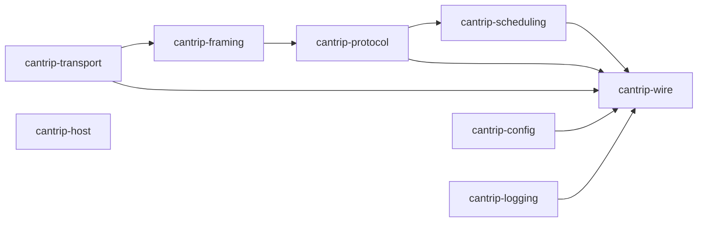

# Rust foundations for the worker port

The Rust server now consumes eight shared libraries under `crates/`. These are
existing implementations moved out of the server, with narrow server adapters or
compatibility re-exports at their original paths. The Node worker remains the
worker implementation. This extraction adds no worker runtime or new protocol.

The baseline is `86f7963df5a87d5da977ff2bcc6f8016a64627ab`, the completed Rust
server replacement. The implementation milestones and local evidence are recorded
below. Each milestone has its own worktree, branch, PR, and squash auto-merge.

## Crates and consumers

Each crate's README documents its public API, ownership, and initialization
requirements. All eight are direct dependencies of `cantrip-server`.

| Crate                                              | Responsibility and production server consumer                                                                                                                        | Future Rust worker use                                                               |
| -------------------------------------------------- | -------------------------------------------------------------------------------------------------------------------------------------------------------------------- | ------------------------------------------------------------------------------------ |
| [cantrip-wire](../crates/cantrip-wire)             | JS-compatible values, UTF-16, JSON/coercion/date/text, host snapshot and canonical digest; consumed through `wire`, `text`, and history adapters                     | Protocol producers/consumers and canonical history publication                       |
| [cantrip-scheduling](../crates/cantrip-scheduling) | Pure cron/calendar/timezone calculations; automation schedule facade and protocol refinements                                                                        | Automation schedule calculations                                                     |
| [cantrip-protocol](../crates/cantrip-protocol)     | Generated contracts, validators/refinements, capability rules, response errors and history/WorkerLink identities; `wire`, settings, history and WorkerLink consumers | Requests, events, notifications, execution and opaque encryption-envelope validation |
| [cantrip-framing](../crates/cantrip-framing)       | CWLK/CTRL, CTTN and CTRS codecs/chunk assembly; WorkerLink, tunnel and remote-surface frame facades                                                                  | Worker frame and stream adapters                                                     |
| [cantrip-config](../crates/cantrip-config)         | Environment-file parsing, readers, errors and lexical paths; `config` and environment loader                                                                         | Worker configuration parsing primitives                                              |
| [cantrip-logging](../crates/cantrip-logging)       | Records, formatting/redaction, buffer/cursors, archive rotation and lifecycle; operations logging adapter                                                            | Worker diagnostics, archive and log-stream foundations                               |
| [cantrip-transport](../crates/cantrip-transport)   | Byte accounting, outgoing peer lifetime, ordered subscriptions/correlation, deadlines and owned async lifetimes; worker bridge/transport adapters                    | Mechanisms for later worker connection and command infrastructure                    |
| [cantrip-host](../crates/cantrip-host)             | Private writes, exclusive publication, pipe EOF and owned Unix child signals; profile, local-key and managed-PostgreSQL adapters                                     | Local persistence and child-cleanup mechanisms                                       |

The shared dependency graph is acyclic:



An arrow points to a dependency. Specifically, protocol depends on wire and
scheduling; framing depends on protocol; transport depends on wire and framing;
config and logging each depend on wire. Scheduling depends on wire. There is no
shared-crate dependency on server startup, routing, repositories, PostgreSQL,
PGlite, Redis, or an HTTP runtime.

The root Cargo workspace contains the server, native worker package and these eight crates. It
shares the original lockfile, dependency patches, release profile, and Rust 1.93
baseline. Desktop, CLI, interaction, CUA, vendored Codex and other third-party
workspaces remain separately owned. `cargo build` defaults to the server; the
existing `cantrip_server_rs/Cargo.toml` entry point and `cantrip-server` executable
remain supported. The exact-match workspace glob avoids Cargo 1.93 treating
nested vendored paths as explicit members.

## Compatibility and ownership

Wire values retain missing/null distinctions, UTF-16 code units, nonfinite
numbers, ECMAScript property ordering, canonical digests, and JSON/date behavior.
The `json!` macro resolves its types inside the defining crate. The host
locale/timezone snapshot is initialized at the original server call sites before
PGlite can alter process state. PGlite's timezone defaults remain server policy.
The moved date implementation retains its V8 license.

`packages/protocol` remains the authoritative TypeScript contract source. The
exporter and source-drift audit now address the 16 generated schema graphs in
`crates/cantrip-protocol/contracts`. Their bytes are unchanged. SQL, provider
catalogs and server policy assets remain under the server. Scheduling's six
legacy timezone files and Croner compatibility license moved with their original
implementation. Scheduling accepts validated schedules; SQL claims, timers and
dispatch remain server-owned.

Frames retain their original immutable bytes, including unknown or differently
ordered header properties, payload ownership, magic bytes, limits and errors.
Server authorization, resource lookup and routing stay outside the codecs.
Concrete response-error types remain downcast-compatible through server
re-exports. WorkerLink identity lengths still count UTF-16 units.

Configuration extraction preserves environment names, precedence, defaults and
secret handling. `ServerConfig`, deployment/origin/proxy policy, database
selection and bootstrap behavior remain in the server. Process environment
loading retains its unsafe startup-only contract and existing OS lookup rules.

Logging uses an instance-owned runtime with explicit process name, level lookup,
archive directory/legacy names and console configuration. The server retains its
singleton, environment policy, lifecycle/version messages, error taxonomy, HTTP
instrumentation, metrics and authenticated log endpoints. Cursor assignment and
archive admission retain their shared lock. Stop producers before closing;
explicit close drains the archive channel and joins its thread. Existing archive
channel and queue policies are preserved, including the unbounded archive
channel. Repeated-summary flushing remains a caller lifecycle responsibility.

Transport retains ordering, first-close behavior, crossing-frame admission,
byte reservations through in-flight writes, and cleanup before correlation
completion. Notification groups are opaque. `WorkerTransport` remains a server
adapter, not a worker client. Request IDs/pending maps, credential and owner
fencing, Redis claims, authorization, admission metrics, callback-error policy,
congestion decisions, concrete timer cancellation and reconnect policy stay in
server adapters. Supplied continuity metadata grants no authority.

Host publication keeps Linux, macOS and Windows operations and Unix parent sync.
Private-directory creation and explicit permission enforcement remain distinct
operations. The Unix signal helper requires an owned unreaped child and an
explicitly created group; it does not infer ownership from persisted PIDs. Pipe
EOF handling receives the reader/name explicitly and preserves EOF/error behavior.
Profile paths, manifests/checksums, migration/recovery, database installation,
PostgreSQL lifetime locks/escalation and Windows pg_ctl job supervision remain
server policy. The Windows job owner couples launcher and recovery behavior;
extracting it would require a process framework outside this goal.

The server still owns durable state, account authorization, routing, scheduling
authority, SQL history ingestion/reconciliation, execution ownership, migrations
and deployment. Workers still own files, Git, PTYs, browsers, native execution
and worker-held secrets. Shared mechanisms create no new app-to-worker paths.

## Foundation available to the later worker port

The independent [shared Rust consumer](../examples/shared-rust-consumer) uses all
eight libraries in its own Cargo workspace/lockfile. It parses configuration,
validates/evaluates a schedule, forwards a binary frame with byte accounting,
creates a canonical digest, publishes private files, closes a log archive and
completes ordered event/response delivery. It requires no Node, server build
script, version/migration generation or database discovery/linking. It is a usage
example, not a worker skeleton.

The later worker port still implements enrollment/credential lifecycle,
connection/reconnect and WorkerLink/WebRTC services, command execution and
admission, files/Git/PTY/browser/runtime management, provider execution, local
journals, history reducers, and platform integration. Existing execution/history
envelopes, identities and canonical digests are reusable; SQL history behavior is
still server-owned.

The server stores encryption material opaquely. Shared envelope validation does
not implement HPKE, component keys, endpoint encryption or worker decryption.
The worker port adds `cantrip-crypto` with native payload/HPKE/KDF primitives
and endpoint key persistence. The worker now supplies authenticated grant
refresh and revision/revocation handling. Protected secret, endpoint, label and
attachment formats and worker provider/MCP secret helpers are now native;
remaining domain/stream adapters and replay/resource lifetimes remain ongoing
work. This new endpoint crate is consumed by the worker,
not the server.

The existing `cantrip-interaction` library already supplies geometry, cursor,
input and ownership primitives. The later worker can integrate native execution
from `cantrip-cua`; capture/input do not move into the server. `cantrip-cli` stays
the worker-authenticated CLI. Their implementations were neither copied nor
reorganized to increase the crate count.

## Delivery and local validation

| Milestone                              | Branch suffix under `agent/manual/` | Delivered PR                                             | Focused evidence                                                                                                                                                   |
| -------------------------------------- | ----------------------------------- | -------------------------------------------------------- | ------------------------------------------------------------------------------------------------------------------------------------------------------------------ |
| 1. Workspace/wire                      | `rust-shared-wire-foundation`       | [#3156](https://github.com/ArcaneArts/Cantrip/pull/3156) | Eight wire tests, JSON/digest oracle, 10,009 ISO values, 4,536 date vectors in each of 15 timezone settings                                                        |
| 2. Protocol/scheduling                 | `rust-shared-protocol-scheduling`   | [#3157](https://github.com/ArcaneArts/Cantrip/pull/3157) | 18 protocol unit tests, generated/JSON/automation fixtures, 34,862 worker-envelope and 17,252 occurrence comparisons, three auth/encryption/HTTP boundary tests    |
| 3. Framing/identities                  | `rust-shared-framing`               | [#3158](https://github.com/ArcaneArts/Cantrip/pull/3158) | 160 tunnel, 127 WorkerLink/chunk, 26 remote-surface cases, 18 Node/Rust identity pairs, error downcasting                                                          |
| 4. Configuration                       | `rust-shared-config`                | [#3159](https://github.com/ArcaneArts/Cantrip/pull/3159) | 1,308 dotenv comparisons and all four server configuration tests, including 977 Node comparisons and real HTTP startup/shutdown                                    |
| 5. Logging                             | `rust-shared-logging`               | [#3160](https://github.com/ArcaneArts/Cantrip/pull/3160) | Buffer/privacy, 65,937 redaction/error cases, 2,136 noise actions, lifecycle/isolation, 172 filesystem steps across 12 archive scenarios and HTTP/console fixtures |
| 6. Transport                           | `rust-shared-transport`             | [#3161](https://github.com/ArcaneArts/Cantrip/pull/3161) | Five mechanism tests and 15 existing server bridge/transport/WorkerLink/tunnel/admission/diagnostic tests                                                          |
| 7. Host resources                      | `rust-shared-host`                  | [#3162](https://github.com/ArcaneArts/Cantrip/pull/3162) | Three independent resource tests, six server profile-file tests, real standalone private-PostgreSQL readiness and stdin shutdown; pg_ctl confirmed stopped         |
| 8. Independent consumption/integration | `rust-shared-integration`           | This change                                              | Independent consumer and Clippy, linked server, artifact staging and production server/Node-worker smoke, dependency/asset audit                                   |

Each extraction passed workspace all-target Clippy with warnings denied,
formatting/diff checks and applicable local source/contract audits. Moved tests
follow their libraries. All 326 external lockfile package identities/checksums
remain unchanged; the independent consumer pins 134 of those existing packages.
No SQL migration, Node worker, client, TypeScript protocol source, or server
`build.rs` changed. Native PGlite export flags, Windows resources/manifests,
embedded versions/migrations, release profiles and patches remain intact.

The Docker source-copy lists include root Cargo files and `crates/`; the existing
server manifest, artifact discovery and desktop/standalone packaging entry points
remain valid. Final integration built the real executable with the supported
build script, staged a macOS ARM64 distribution with its embedded/bundled PGlite
runtime and private PostgreSQL assets, and ran its `start.sh` with PGlite. Health,
readiness, actual Node enrollment/heartbeat/WebSocket readiness, one HTTP-dispatched
`worker.version` round trip and stdin shutdown passed. The controlled handler
returns the existing Node version result and explicitly declines unrelated
background domain commands; this does not claim full worker runtime coverage.
The temporary package/database were removed after retaining small reports.

Actual fixture issues were corrected without changing production behavior: a
missing worker dependency link needed a retry; tunnel lifecycle events now follow
the existing Node oracle's no-op; standalone smoke omits the development token;
the final smoke supplies JSON content type only with a body and compares version
results after the authoritative schema strips build metadata. The broad
all-schema mutation run was intentionally stopped and is not counted as passing.

Validation was local on macOS ARM64 with Rust 1.93 and Node 24.22.2. Windows/Linux
implementations were preserved but no new platform execution campaign ran.
External PostgreSQL support was preserved without repeating its full database
qualification matrix. No full repository suite, physical-device/VM tests,
signing/notarization, deployment, benchmarks or GitHub Actions ran for this goal.

## Focused local commands

Reuse the existing shared target directory, disabled incremental compilation, two
build jobs and no dev/test debug information. The server wrapper supplies these
defaults; the independent consumer's README shows direct Cargo usage with the
same cache. Direct library builds do not run the server build script.

```sh
pnpm server:rust:check
node scripts/server-rust/cargo.mjs test -p cantrip-transport --test mechanisms
node scripts/server-rust/build.mjs
node --import tsx scripts/server-rust/shared-crates-smoke.mjs --binary /absolute/path/to/cantrip-server
```

The smoke requires the existing protocol/logging/version package build artifacts
and local Node worker development dependencies. It creates its own disposable
profile and worker credentials and removes them after orderly server shutdown.
Run only the tests relevant to a future change; this extraction does not establish
a new mandatory broad QA gate. GitHub Actions remains for releases/deployments.
